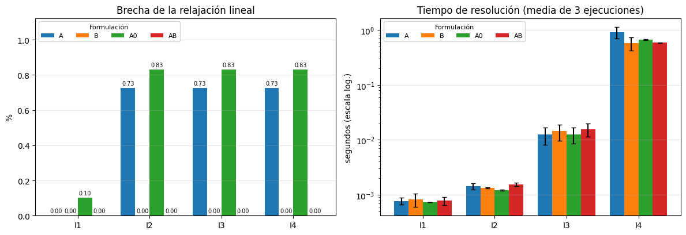
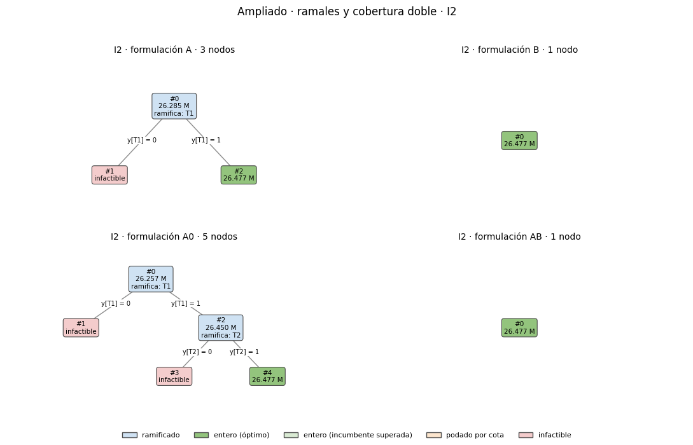
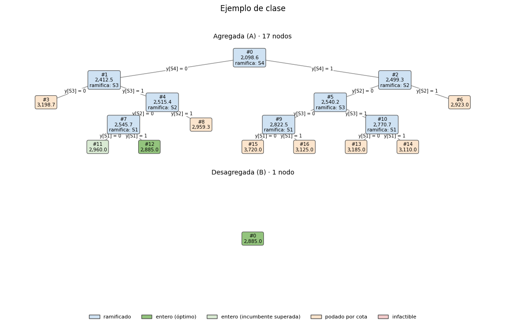

# Taller 2 · Reformulación de un modelo entero mixto

## Distribución de oxígeno medicinal en un hospital: vínculo agregado frente a vínculo desagregado

**Investigación de Operaciones** · Doctorado en Ingeniería, consorcio UV–UTA · Octubre de 2026
**Integrantes:** Eyleen Spencer Yates · Sebastián Ibarra Vera

[](https://colab.research.google.com/github/USUARIO/REPOSITORIO/blob/main/Taller2_Oxigeno.ipynb)

---

## Resumen

Un hospital debe decidir qué fuentes de oxígeno medicinal habilitar (dos estanques y bancos de cilindros) y cuánto asignar de cada una a cada punto de consumo, minimizando el costo de 4 semanas. Se comparan cuatro formulaciones de la restricción que impide enviar desde una fuente no habilitada: agregada con constante genérica (A0), agregada con la menor constante válida (A), desagregada (B) y ambas a la vez (AB). Las cuatro tienen el mismo conjunto de soluciones enteras, lo que se demuestra algebraicamente y se verifica de forma numérica.

Con los datos del hospital tal como son, **la brecha de la relajación es nula en todas las formulaciones**: Indura es la fuente más barata para todos los puntos, y el respaldo obliga a pagar al menos un costo fijo de estanque. En un **escenario ampliado** con ramales por sector y cobertura doble en áreas críticas, la agregada presenta brecha (0,83 % con A0 y 0,73 % con A, desde I2 hasta I4) y **la desagregada la cierra por completo** en las cuatro instancias. Un branch and bound explícito sobre I2 pasa de 5 nodos (A0) a 3 (A) y a 1 (B y AB). HiGHS resuelve todo en la raíz, pero en I4 necesita 95 cortes con A y 206 con A0, y ninguno con B ni AB. Los tiempos no muestran diferencias distinguibles.

---

## Contenido del repositorio

```
├── README.md                 este documento
├── Taller2_Oxigeno.ipynb     cuaderno de resultados: reproduce todas las tablas y figuras
├── requirements.txt          versiones de las bibliotecas y del solver
└── figuras/                  figuras de este README, generadas por el cuaderno
```

Las instancias no se almacenan aparte: las produce un generador determinista dentro del cuaderno (semilla declarada `SEMILLA = 2026`) y se guardan en `taller2_<escenario>/datos/` al ejecutarlo.

## Cómo reproducir

**En Google Colab.** Abrir el cuaderno con el botón de arriba y ejecutar *Entorno de ejecución → Ejecutar todas*. La primera celda instala las versiones exactas de Pyomo y HiGHS. La ejecución completa toma pocos minutos y no requiere intervención manual. Al final, el cuaderno comprime y descarga todos los resultados.

**En un equipo local.**

```bash
pip install -r requirements.txt
jupyter nbconvert --to notebook --execute Taller2_Oxigeno.ipynb
```

**Escenarios.** La celda de configuración (sección 2 del cuaderno) define `ESCENARIO = "ampliado"`, el caso principal. Con `ESCENARIO = "real"` se reproduce el caso base. Cada escenario escribe sus resultados en su propia carpeta.

---

## 1. Problema y vinculación con la línea de investigación

El suministro de oxígeno medicinal es una de las instalaciones críticas de un establecimiento de salud. Su interrupción tiene consecuencias clínicas inmediatas, y su configuración combina contratos con proveedores, equipamiento en comodato y exigencias de respaldo. El problema pertenece a la **ingeniería clínica**, en particular a la gestión de gases medicinales.

**Decisión.** El modelo decide qué fuentes habilitar (dos estanques de oxígeno líquido y bancos de cilindros) y cuánto oxígeno entrega cada fuente a cada punto de consumo clínico (Pabellón, UPC y Hospitalización, desagregables hasta el nivel de cama o habitación), minimizando el costo total en un horizonte de 4 semanas.

**Necesidad de variables discretas.** Habilitar una fuente tiene un costo que no depende del volumen entregado: la mantención de las tomas de la red, en el caso de los estanques, y el arriendo de los cilindros, en el caso de los bancos. Además, la operación exige fuentes de respaldo y, en el escenario ampliado, cobertura doble en áreas críticas. Ninguna de estas condiciones puede representarse sin una decisión binaria de habilitación.

---

## 2. Datos

Los datos provienen del hospital, salvo los marcados como supuesto. El horizonte es de 4 semanas, que se toma como equivalente a un mes.

| Dato | Valor | Origen |
|---|---|---|
| Demanda de Hospitalización | 543 camas · 85 % de ocupación · 20 % con O₂ · 3 L/min → 11.165,82 m³ | Hospital |
| Demanda de UPC | 159 camas · 90 % de ocupación · 75 % con O₂ · 10 L/min → 43.273,44 m³ | Hospital |
| Demanda de Pabellón | 19 pabellones · 240 m³/semana → 960,00 m³ | Hospital |
| Demanda total D | 55.399,26 m³ | Calculada |
| Precio por m³ | Indura $435 · Air Liquide $588 · AGA/Linde $949 | Hospital |
| Transporte de cilindros | $214 por m³ | Hospital |
| Mantención de tomas | $28.800 por toma al año, solo en suministro por red | Hospital |
| Tomas | 159 en UPC (1 por cama) · 543 en Hospitalización (3 por habitación de 3 camas) · 38 en Pabellón (2 por pabellón) · 740 en total | Hospital |
| Estanques | 2 estanques LOX de 30 m³, equivalentes a 26.100 m³ de gas por llenado; reposiciones ilimitadas | Hospital |
| Arriendo de cilindros | $12.000 por cilindro al mes | Hospital |
| Reserva obligatoria | 100 cilindros de 0,6 m³ ($1.200.000), no utilizables para la demanda normal | Hospital |
| Proveedor de cada estanque | T1 Air Liquide · T2 Indura | Supuesto |
| Bancos operativos | 20 cilindros de 0,6 m³, 4 recambios en el horizonte (48 m³); arriendo $240.000 | Supuesto (recambios) |
| Número de bancos en I2 a I4 | 4, 10 y 42 (19 manifolds de pabellón, 14 estaciones de enfermería y 9 de emergencia) | Supuesto |
| Reparto de demanda por especialidad (I2, I3) | Pesos aleatorios en [0,5; 1,5] con semilla 2026 | Supuesto |

La reserva de 100 cilindros se paga igual en toda solución, así que es una constante: queda fuera del modelo y se suma después (`z_total`). Las brechas se calculan sobre el costo sin esa constante.

### Instancias

Las cuatro instancias representan el mismo hospital con resolución creciente. La demanda total es la misma en todas.

| Instancia | Fuentes | Puntos de suministro | Puntos |
|---|---|---|---|
| I1 | 2 estanques + 1 banco | Servicio general | 3 |
| I2 | 2 estanques + 4 bancos | 3 especialidades por servicio | 9 |
| I3 | 2 estanques + 10 bancos | Pabellón por pabellón (19); UPC y Hospitalización por especialidad (6 + 6) | 31 |
| I4 | 2 estanques + 42 bancos | Pabellón por pabellón (19); UPC por cama (159); Hospitalización por habitación (181) | 359 |

---

## 3. Escenarios

**Escenario real.** Datos del hospital tal como son. Cada estanque alcanza todos los puntos y, si se habilita, paga la mantención de las 740 tomas ($1.639.385 en 4 semanas). Debe haber al menos un estanque habilitado, además de la reserva de cilindros.

**Escenario ampliado (caso principal).** Agrega cuatro rasgos posibles en un hospital. Son supuestos plausibles, no datos del hospital:

1. **Ramales por sector.** T1 (Air Liquide) alimenta Pabellón y UPC; T2 (Indura) alimenta UPC y Hospitalización. Pabellón solo puede recibir de T1 o de cilindros.
2. **Mantención por ramal.** T1 paga las 197 tomas de su ramal ($436.431) y T2 las 702 del suyo ($1.555.200). Si ambos se habilitan, las tomas de UPC se pagan a los dos proveedores, porque cada uno mantiene su conexión.
3. **Cilindros de alcance flexible.** Los bancos pueden llevarse a cualquier punto, para cubrir demanda remanente o un procedimiento específico.
4. **Cobertura doble.** Cada punto de Pabellón y de UPC debe tener al menos dos fuentes habilitadas que puedan abastecerlo: una primaria y una de respaldo.

El escenario ampliado existe porque, con los datos reales, la comparación entre formulaciones es nula por construcción (sección 8.4). No altera los datos de una instancia entre formulaciones: define un problema distinto, con los mismos datos para las cuatro.

---

## 4. Modelo matemático

### Conjuntos, parámetros y variables

| Símbolo | Significado |
|---|---|
| $S$, $C$ | Fuentes y puntos de suministro |
| $S(c)$, $C(s)$ | Fuentes que alcanzan el punto $c$; puntos que alcanza la fuente $s$ |
| $R \subseteq S$ | Fuentes de respaldo (los estanques) |
| $d_c$ | Demanda del punto $c$ en el horizonte (m³) |
| $D = \sum_c d_c$, $D_s = \sum_{c \in C(s)} d_c$ | Demanda total y demanda que la fuente $s$ puede atender |
| $U_s$ | Capacidad de la fuente $s$ en el horizonte (m³); con reposiciones ilimitadas, $U_s = D$ |
| $F_s$ | Costo fijo de habilitar la fuente $s$ ($) |
| $c_{sc}$ | Costo unitario de suministrar de $s$ a $c$: precio más transporte ($/m³) |
| $k$, $m_c$ | Mínimo de estanques habilitados; cobertura mínima del punto crítico $c$ |
| $x_{sc} \ge 0$ | m³ que la fuente $s$ entrega al punto $c$ |
| $y_s \in \{0,1\}$ | 1 si la fuente $s$ está habilitada |

### Función objetivo y restricciones comunes

$$\min \; Z = \sum_{s \in S} F_s \, y_s + \sum_{s \in S} \sum_{c \in C(s)} c_{sc} \, x_{sc}$$

$$\sum_{s \in S(c)} x_{sc} = d_c \qquad \forall c \in C \qquad \text{(demanda)}$$

$$\sum_{c \in C(s)} x_{sc} \le U_s \qquad \forall s \in S \qquad \text{(capacidad)}$$

$$\sum_{s \in R} y_s \ge k \qquad \text{(respaldo, } k = 1\text{)}$$

$$\sum_{s \in S(c)} y_s \ge m_c \qquad \forall c \text{ crítico} \qquad \text{(cobertura, solo escenario ampliado, } m_c = 2\text{)}$$

### Restricciones de vínculo: las cuatro formulaciones

| Formulación | Restricción | Filas | Transformación (Vielma, 2015) |
|---|---|---|---|
| **A0**, agregada con M genérica | $\sum_{c \in C(s)} x_{sc} \le D \, y_s \quad \forall s$ | una por fuente | Punto de partida |
| **A**, agregada ajustada | $\sum_{c \in C(s)} x_{sc} \le \min(U_s, D_s) \, y_s \quad \forall s$ | una por fuente | Ajuste de constantes de activación |
| **B**, desagregada | $x_{sc} \le \min(d_c, U_s) \, y_s \quad \forall s, \; c \in C(s)$ | una por arco | Desagregación de restricciones de vínculo |
| **AB** | A y B a la vez | ambas | Incorporación de desigualdades válidas |

**Derivación de las constantes.** Por la restricción de capacidad, una fuente no entrega más que $U_s$; por la de demanda y la no negatividad, no entrega más que la demanda que alcanza, $D_s$, ni más que $d_c$ a un punto. Por tanto $\min(U_s, D_s)$ y $\min(d_c, U_s)$ son cotas válidas, y no hay otras menores que valgan en general.

---

## 5. Equivalencia de las formulaciones

**Procedimiento declarado:** argumento algebraico, con verificación numérica complementaria.

**Argumento algebraico.** Las cuatro formulaciones comparten la función objetivo y las restricciones comunes; solo difieren en el vínculo. Para cada fuente $s$, con $y_s$ binaria:

- **Si $y_s = 0$:** A y A0 dan $\sum_c x_{sc} \le 0$, y B da $x_{sc} \le 0$ para cada $c$. Con $x \ge 0$, todas imponen $x_{sc} = 0$.
- **Si $y_s = 1$:** los cuatro vínculos son redundantes, porque la demanda y la capacidad ya implican $x_{sc} \le \min(d_c, U_s)$ y $\sum_c x_{sc} \le \min(U_s, D_s) \le D$.

Como el razonamiento vale para cada fuente por separado, las cuatro formulaciones admiten exactamente los mismos pares $(x, y)$ enteros factibles y alcanzan el mismo óptimo. Esto supone $d_c > 0$ y $U_s > 0$, que el cuaderno verifica.

**Verificación numérica** (sección 7 del cuaderno):

| Instancia | Combinaciones de $y$ | Factibles | Discrepancias entre formulaciones |
|---|---|---|---|
| I1 | 8 | 1 | 0 |
| I2 | 64 | 15 | 0 |

Para cada combinación de $y$ se fija $y$ y se resuelve el problema en $x$ con las cuatro formulaciones. En todas coinciden el estado (factible o infactible) y el costo. Además, en las cuatro instancias los óptimos enteros de las cuatro formulaciones coinciden dentro de la tolerancia de HiGHS ($10^{-4}$ relativo).

---

## 6. Hipótesis

La relajación lineal de B debería ser al menos tan ajustada como la de A0. Al sumar las restricciones de B sobre $c$ se obtiene $\sum_c x_{sc} \le y_s \sum_c \min(d_c, U_s) \le D_s \, y_s \le D \, y_s$, que es la restricción de A0. Si además $U_s \ge D_s$, la suma reproduce exactamente A, y B es al menos tan ajustada como A para esa fuente. Si $U_s < D_s$ no hay inclusión garantizada: con dos puntos de demanda 10 y $U_s = 15$, el punto $x = (10, 0)$, $y_s = 0{,}7$ cumple A y viola B, y el punto $x = (5, 5)$, $y_s = 0{,}6$ cumple B y viola A.

En el escenario ampliado, los estanques cumplen $U_s \ge D_s$ y los bancos no. Por eso se esperaba que B mejorara la relajación de A en lo que depende de los estanques, sin garantía en lo que depende de los bancos. En tiempo, se esperaba que la ventaja de B pudiera atenuarse con la escala, porque su número de filas crece con el número de arcos.

---

## 7. Diseño experimental

| Elemento | Valor |
|---|---|
| Instancias | I1 a I4, de 3 a 359 puntos y de 3 a 44 fuentes |
| Formulaciones | A, B, A0 y AB, generadas por una misma función con los mismos datos |
| Solver | HiGHS 1.15.1 vía `highspy`, parámetros por defecto |
| Límite de tiempo | 300 s por resolución entera, idéntico para todas las formulaciones (única opción fijada) |
| Repeticiones | 3 por instancia y formulación; se reportan media y desviación estándar del tiempo |
| Orden | Rotación de las formulaciones en cada repetición |
| Tiempo medido | Solo `run()` de HiGHS; excluye construir y leer el modelo |

**Instrumentos.** Las relajaciones lineales se resuelven por separado como LP. Nodos, valor óptimo, cota dual y brecha final se leen de `getInfo()` de HiGHS. Los cortes y la cota raíz salen del registro de resolución: cortes generados es el máximo de la columna `Cuts`, y cortes activos es `InLp` en la última fila. Las dimensiones corresponden al modelo leído por HiGHS antes del presolve.

**Branch and bound explícito.** Como HiGHS resuelve todas las instancias en la raíz, I1 e I2 se resuelven además con un branch and bound escrito a mano, sin presolve, cortes ni heurísticas. Ramifica sobre la $y_s$ más fraccionaria, elige el nodo de mejor cota y poda por infactibilidad, integralidad o cota. Es un instrumento complementario: el indicador de nodos del enunciado es el de HiGHS. Se validó contra el ejemplo de clase (cuaderno `02_Formulaciones`), cuyas cifras reproduce exactamente.

### Declaración de entorno

| Componente | Versión o característica |
|---|---|
| Plataforma | Google Colab, 9 de octubre de 2026 |
| Sistema operativo | Linux 6.6.122 x86_64 (glibc 2.39) |
| Procesador | Intel Xeon @ 2,20 GHz, 2 núcleos lógicos |
| Memoria | 12,7 GiB |
| Python | 3.13.16 |
| Pyomo | 6.10.1 |
| HiGHS / highspy | 1.15.1 |
| NumPy · SciPy · pandas · Matplotlib | 2.1.3 · 1.16.3 · 2.2.3 · 3.10.0 |

---

## 8. Resultados

### 8.1 Brecha de la relajación (escenario ampliado)

| Instancia | A0 | A | B | AB |
|---|---|---|---|---|
| I1 | 0,10 % | 0,00 % | 0,00 % | 0,00 % |
| I2 | 0,83 % | 0,73 % | 0,00 % | 0,00 % |
| I3 | 0,83 % | 0,73 % | 0,00 % | 0,00 % |
| I4 | 0,83 % | 0,73 % | 0,00 % | 0,00 % |



### 8.2 Los siete indicadores (escenario ampliado)

| Inst. | Form. | Variables | Restricciones | No nulos | Cota LP ($) | Brecha relaj. | Nodos | Cortes gen./act. | Tiempo (s) | Brecha final |
|---|---|---|---|---|---|---|---|---|---|---|
| I1 | A | 10 | 12 | 31 | 26.477.187,83 | 0,00 % | 0 | 0 / 0 | 0,001 ± 0,000 | 0 % |
| I1 | B | 10 | 16 | 35 | 26.477.187,83 | 0,00 % | 0 | 0 / 0 | 0,001 ± 0,000 | 0 % |
| I1 | A0 | 10 | 12 | 31 | 26.450.238,15 | 0,10 % | 0 | 0 / 0 | 0,001 ± 0,000 | 0 % |
| I1 | AB | 10 | 19 | 45 | 26.477.187,83 | 0,00 % | 0 | 0 / 0 | 0,001 ± 0,000 | 0 % |
| I2 | A | 54 | 24 | 163 | 26.285.020,20 | 0,73 % | 0 | 0 / 0 | 0,001 ± 0,000 | 0 % |
| I2 | B | 54 | 66 | 205 | 26.477.187,83 | 0,00 % | 0 | 0 / 0 | 0,001 ± 0,000 | 0 % |
| I2 | A0 | 54 | 24 | 163 | 26.257.211,28 | 0,83 % | 0 | 0 / 0 | 0,001 ± 0,000 | 0 % |
| I2 | AB | 54 | 72 | 259 | 26.477.187,83 | 0,00 % | 0 | 0 / 0 | 0,002 ± 0,000 | 0 % |
| I3 | A | 359 | 58 | 1.078 | 26.285.020,07 | 0,73 % | 1 | 0 / 0 | 0,012 ± 0,004 | 0 % |
| I3 | B | 359 | 393 | 1.413 | 26.477.187,69 | 0,00 % | 1 | 0 / 0 | 0,014 ± 0,005 | 0 % |
| I3 | A0 | 359 | 58 | 1.078 | 26.257.211,16 | 0,83 % | 1 | 0 / 0 | 0,013 ± 0,004 | 0 % |
| I3 | AB | 359 | 405 | 1.772 | 26.477.187,69 | 0,00 % | 1 | 0 / 0 | 0,016 ± 0,004 | 0 % |
| I4 | A | 15.640 | 450 | 46.921 | 26.285.020,02 | 0,73 % | 1 | 95 / 7 | 0,909 ± 0,215 | 0 % |
| I4 | B | 15.640 | 16.002 | 62.473 | 26.477.187,65 | 0,00 % | 1 | 0 / 0 | 0,574 ± 0,156 | 0 % |
| I4 | A0 | 15.640 | 450 | 46.921 | 26.257.211,11 | 0,83 % | 1 | 206 / 20 | 0,668 ± 0,016 | 0 % |
| I4 | AB | 15.640 | 16.046 | 78.113 | 26.477.187,65 | 0,00 % | 1 | 0 / 0 | 0,585 ± 0,008 | 0 % |

Las cuatro formulaciones alcanzan el mismo óptimo en cada instancia: **$26.477.187,83** en I1 e I2, $26.477.187,69 en I3 y $26.477.187,65 en I4. Con la reserva de cilindros, el costo total es de unos $27.677.188 en 4 semanas. Las diferencias de centavos entre instancias se deben al redondeo de la demanda de cada punto al repartirla, no a las formulaciones. Todas las corridas terminaron en `Optimal`, de modo que la brecha de optimalidad final es nula en todas. La tabla completa, con la cota raíz, el cociente de integralidad y el cierre en la raíz, la genera el cuaderno en `resultados/tabla_resultados.csv`.

### 8.3 Solución óptima (escenario ampliado)

| Fuente | Habilitada | Entrega | Costo en 4 semanas |
|---|---|---|---|
| T1 (Air Liquide) | Sí | Pabellón: 960 m³ | $436.431 de mantención + $564.480 de oxígeno |
| T2 (Indura) | Sí | UPC y Hospitalización: 54.439,26 m³ | $1.555.200 de mantención + $23.681.077 de oxígeno |
| Un banco de cilindros | Sí, sin flujo | Respaldo para la cobertura doble de Pabellón | $240.000 de arriendo |
| **Total del modelo** | | | **$26.477.188** |

T1 se habilita solo para abastecer Pabellón, el 1,7 % de la demanda total, porque es la única fuente de red que llega ahí. Esa es la estructura que separa a las formulaciones: la relajación agregada permite abrir T1 en una fracción mínima, mientras que la desagregada lo obliga a abrirse completo apenas atiende por completo un punto.

### 8.4 Branch and bound explícito (I1 e I2)

| Caso | Instancia | Brecha de la relajación (A0 / A / B / AB) | Nodos del árbol (A0 / A / B / AB) |
|---|---|---|---|
| Ejemplo de clase (validación) | — | 27,26 % / 27,26 % / 0 % / 0 % | 17 / 17 / 1 / 1 |
| Ampliado | I1 | 0,10 % / 0 % / 0 % / 0 % | 3 / 1 / 1 / 1 |
| Ampliado | I2 | 0,83 % / 0,73 % / 0 % / 0 % | 5 / 3 / 1 / 1 |
| Real | I1 | 0 / 0 / 0 / 0 | 1 / 1 / 1 / 1 |
| Real | I2 | 0 / 0 / 0 / 0 | 1 / 1 / 1 / 1 |

En el ejemplo de clase, el código reproduce las cifras publicadas: 2.098,61 para la relajación agregada, 2.885,00 para la desagregada y para el óptimo.





En I2, con A0 el árbol primero ramifica sobre T1 y luego sobre T2: ambas ramas en cero son infactibles. Con A basta la ramificación sobre T1. Con B y AB la relajación ya es entera. En las 8 comparaciones con HiGHS (I1 e I2, cuatro formulaciones), la cota raíz del árbol explícito coincide con la relajación lineal de HiGHS y el óptimo coincide con el de HiGHS.

**Caso real.** Con `ESCENARIO = "real"`, la brecha de la relajación es 0 % en las cuatro formulaciones y las cuatro instancias, con un óptimo de $25.738.062 (Indura abastece toda la demanda) y $26.938.062 con la reserva. La razón no depende de los vínculos: el respaldo obliga a pagar al menos un costo fijo de estanque, y ningún m³ cuesta menos que el de Indura. Toda relajación cuesta entonces al menos lo mismo que la solución entera, y quitar por completo las restricciones de vínculo da la misma cota.

---

## 9. Discusión

**Brecha de la relajación frente a brecha de optimalidad.** Todas las corridas alcanzaron el óptimo, así que la brecha de optimalidad final es nula en todas. La diferencia entre formulaciones está únicamente en la relajación lineal: es una diferencia de calidad del modelo, no de cuán lejos llegó el solver.

**Atribución entre formulación y solver.** HiGHS cerró en la raíz la brecha de A y A0 en todas las instancias. En I2 lo hizo sin cortes ni ramificación, y en I4 necesitó 95 cortes generados (7 activos) con A y 206 (20 activos) con A0. Con B y AB no generó ninguno, porque no había brecha que cerrar. La mejora de B es, por tanto, atribuible a la formulación. Con A y A0, el mismo resultado final se obtiene gracias a la separación automática de cortes del solver. El branch and bound explícito, sin esas ayudas, muestra el trabajo que cada formulación deja al árbol: 5, 3 y 1 nodos en I2.

**Efecto de la escala.** La brecha de A y A0 se mantiene constante de I2 a I4 (0,73 % y 0,83 %), y la de B y AB se mantiene en cero: la ventaja de la desagregada se manifiesta y se mantiene al crecer la instancia. Su costo es el tamaño. En I4, B tiene 16.002 restricciones frente a 450 de A (unas 36 veces) y 62.473 no nulos frente a 46.921. Los tiempos de I4 (0,91 ± 0,22 s con A; 0,57 ± 0,16 s con B; 0,67 ± 0,02 s con A0; 0,59 ± 0,01 s con AB) tienen desviaciones del mismo orden que sus diferencias, y su orden no se corresponde con la calidad de la cota: A0 fue más rápida que A, con peor relajación. Con tres repeticiones y tiempos menores a un segundo no puede afirmarse que una formulación sea más rápida, ni atribuir a la brecha una diferencia de tiempo.

**Magnitud.** En porcentaje las brechas son pequeñas porque el costo del oxígeno (cerca de $24 millones) diluye los costos fijos. En pesos, la brecha de A en I2 es de $192.168 y la de A0 de $219.977. Eso equivale al 28 % y al 33 % de los costos fijos que la decisión pone en juego: abrir T1 y un banco, $676.431. Es una proporción del mismo orden que la brecha de 27 % del ejemplo de clase.

**Verificación de la hipótesis.** En el escenario ampliado la hipótesis se verificó: B fue al menos tan ajustada como A y A0 en todas las instancias, y estrictamente más ajustada desde I2; AB coincidió con B. La no garantía teórica cuando $U_s < D_s$, que es el caso de los bancos, no se manifestó con estos datos, porque la brecha se origina en el estanque T1. En el escenario real la hipótesis no se puede contrastar, porque la brecha es nula en todas las formulaciones, por las razones de la sección 8.4. La parte de desempeño de la hipótesis tampoco se verificó: no hubo diferencias de tiempo distinguibles en ningún sentido.

---

## 10. Conclusiones

1. Con los datos del hospital, la elección de formulación es irrelevante para la relajación. La estructura de costos y la exigencia de respaldo ya fijan la cota en el óptimo entero. Es un efecto nulo correctamente medido, y su causa está identificada.
2. Cuando la red está sectorizada y hay exigencia de cobertura doble, una fuente pasa a ser necesaria para una parte pequeña de la demanda. Ahí la desagregación del vínculo elimina la brecha de la relajación, y la formulación agregada solo la alcanza con la ayuda de los cortes del solver.
3. Ajustar la constante (de A0 a A) reduce la brecha, pero no la elimina. La desagregación sí, a cambio de un modelo unas 36 veces más largo en restricciones, sin un costo de tiempo detectable en instancias de este tamaño.

## 11. Limitaciones

- **Escenario ampliado.** Los ramales, la mantención por ramal, el alcance de los cilindros y la cobertura doble son supuestos plausibles, no datos del hospital. La mantención por ramal cobra las tomas de UPC a ambos proveedores cuando los dos se habilitan.
- **Horizonte.** Es un solo período agregado de 4 semanas, con demanda determinista, sin niveles de estanque, tiempos de reposición ni picos de consumo.
- **Incertidumbre.** No se modela la suspensión del suministro de Indura cuando el hospital se atrasa en los pagos, que es un problema real. Requeriría incorporar incertidumbre o escenarios de falla.
- **Tamaño.** Todas las instancias se resuelven en menos de un segundo, de modo que el diseño no permite observar efectos de tiempo. El hardware de Colab, además, varía entre sesiones.
- **Branch and bound explícito.** Usa una sola regla de ramificación y de selección, así que sus conteos de nodos ilustran el mecanismo pero no se generalizan.
- **Proveedores y bancos.** El proveedor de cada estanque, el número de bancos y los recambios de cilindros son supuestos.

---

## Referencias

- Bynum, M. L., Hackebeil, G. A., Hart, W. E., Laird, C. D., Nicholson, B. L., Siirola, J. D., Watson, J.-P. y Woodruff, D. L. (2021). *Pyomo — Optimization Modeling in Python* (3.ª ed.). Springer.
- Cornuéjols, G. (2008). Valid inequalities for mixed integer linear programs. *Mathematical Programming*, 112(1), 3–44.
- Cornuéjols, G., Nemhauser, G. L. y Wolsey, L. A. (1990). The uncapacitated facility location problem. En P. B. Mirchandani y R. L. Francis (Eds.), *Discrete Location Theory* (pp. 119–171). Wiley.
- Huangfu, Q. y Hall, J. A. J. (2018). Parallelizing the dual revised simplex method. *Mathematical Programming Computation*, 10(1), 119–142.
- Morales-España, G., Latorre, J. M. y Ramos, A. (2013). Tight and compact MILP formulation for the thermal unit commitment problem. *IEEE Transactions on Power Systems*, 28(4), 4897–4908.
- Vielma, J. P. (2015). Mixed integer linear programming formulation techniques. *SIAM Review*, 57(1), 3–57.
- Wolsey, L. A. (2020). *Integer Programming* (2.ª ed.). Wiley.
